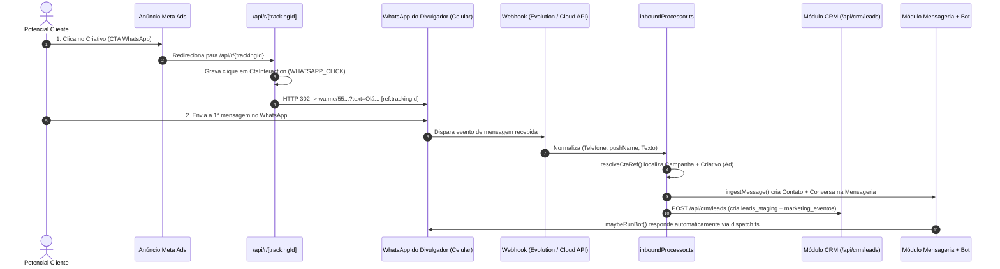
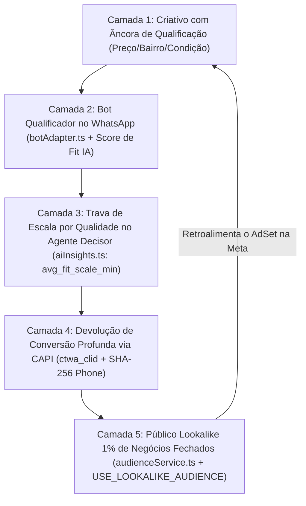

# Relatório Técnico, Estratégico e Operacional: Integração Ponta a Ponta entre Campanhas Meta Ads (CTA WhatsApp), CRM e Mensageria Híbrida (Bot + Humano no Celular)

> **Escopo do Documento:** Consolidação integral da análise arquitetural, diagnóstico de código da plataforma `net-imobiliaria`, regras de negócio e tarifação da API Oficial da Meta (WhatsApp Cloud API), requisitos de credenciamento para o modo de Coexistência (*WhatsApp Business App Coexistence*), análise de estabilidade e risco da Evolution API e engenharia de mitigação de leads curiosos (*Loop do ICP* e *Conversions API*).

---

## 1. Definição do Desafio Operacional e Premissas Fundamentais

A aplicação integra três módulos de negócio que precisam operar como um organismo único, mantendo simultaneamente sua independência modular:
1. **Módulo de Gestão de Campanhas de Marketing Digital:** Focado no lançamento, rastreamento e otimização de tráfego pago na Meta (Facebook e Instagram), associando cada criativo (`Ad`) a um Call-to-Action (CTA) de WhatsApp.
2. **Módulo de CRM:** Responsável por receber o lead gerado a partir do criativo, deduplicar sua identidade, qualificá-lo, registrá-lo no funil de vendas (Kanban) e distribuí-lo aos corretores/atendentes.
3. **Módulo de Mensageria (Foco em WhatsApp):** Responsável por centralizar a conversa iniciada pelo potencial cliente, utilizando **Bots de IA** para qualificação inicial e resposta automática a dúvidas (estoque, preços, fotos, base de conhecimento) e permitindo que **atendentes humanos** assumam a continuidade do atendimento — **inclusive respondendo diretamente pelo aplicativo do WhatsApp instalado no celular do divulgador**.

### 1.1. A Regra de Privacidade da Meta: Diferença entre "Clique no Criativo" e "Lead Identificado"
Por imposição técnica e de privacidade (LGPD/GDPR) da própria Meta, **um clique isolado em um anúncio com CTA de WhatsApp é um evento anônimo**. No momento em que o usuário toca no botão do anúncio no Instagram ou Facebook, a Meta não transmite o nome nem o número de telefone desse usuário para nenhum servidor externo.

Consequentemente, a captura automatizada ocorre obrigatoriamente em **dois estágios sequenciais**:
* **Estágio 1 — O Clique (Interação de Mídia Anônima):** O clique aciona o destino do anúncio carregando um identificador único rastreável daquele criativo/campanha. Nesse instante, contabiliza-se o interesse de mídia (`WHATSAPP_CLICK`), mas ainda não há telefone nem nome para abrir um card nominal no CRM.
* **Estágio 2 — O Envio da 1ª Mensagem no WhatsApp (Materialização do Lead):** Quando o aplicativo do WhatsApp se abre no celular do potencial cliente e ele pressiona "Enviar", a mensagem chega ao número do divulgador. Nesse milissegundo, o Webhook captura o **telefone real** do remetente, o **nome público do perfil (`pushName`)**, o **texto enviado** e a **referência da campanha/criativo**, criando simultaneamente o registro na **Mensageria** e o Lead nominal no **CRM**, além de acionar o **Bot**.

---

## 2. Raio-X Técnico: O Que Já Está Construído no Código da Plataforma

A inspeção do repositório demonstra que a arquitetura canônica para unir os três módulos já foi implementada em grande parte. Abaixo está o mapeamento exato de como os arquivos atuais processam esse ciclo:



### 2.1. Lançamento da Campanha e Vínculo do Criativo
* **Arquivos:** [`src/app/api/admin/campanhas/campaigns/route.ts`](file:///c:/NetImobiliária/net-imobiliaria/src/app/api/admin/campanhas/campaigns/route.ts#L252-L426) e [`src/lib/marketing/networks/meta/metaAdsAdapter.ts`](file:///c:/NetImobiliária/net-imobiliaria/src/lib/marketing/networks/meta/metaAdsAdapter.ts#L896-L1060).
* **Funcionamento atual:** Ao publicar uma campanha, o sistema cria os registros nas tabelas `campanhasmarketingdigital."Campaign"`, `"AdSet"` e `"Ad"`. Para cada anúncio (`Ad`), gera um `trackingId` único (`${campaign.id.slice(0, 8)}-${Date.now().toString(36)}`) e constrói a URL rastreada `https://<dominio-do-tenant>/api/r/<trackingId>`. Essa URL é enviada para a Meta como link de destino do criativo (`object_story_spec.link_data.link`), e os IDs externos gerados pela Meta (`externalId`, `externalAdSetId`, `externalAdId`) são persistidos no banco local.

### 2.2. Rota de Rastreamento de Clique e Cascata de Número WhatsApp
* **Arquivos:** [`src/app/api/r/[trackingId]/route.ts`](file:///c:/NetImobiliária/net-imobiliaria/src/app/api/r/%5BtrackingId%5D/route.ts#L59-L178) e [`src/lib/marketing/services/whatsappConfigResolver.ts`](file:///c:/NetImobiliária/net-imobiliaria/src/lib/marketing/services/whatsappConfigResolver.ts).
* **Funcionamento atual:** Quando o usuário clica no anúncio, a requisição GET atinge `/api/r/[trackingId]`. O endpoint localiza o `Ad`, o `AdSet` e a `Campaign`, registra o clique na tabela `campanhasmarketingdigital."CtaInteraction"` com `eventType: 'WHATSAPP_CLICK'` (incluindo UTMs, IP e User-Agent) e resolve para qual número de WhatsApp deve redirecionar usando a cascata **Cliente da Agência (`client_id`) → Tenant (`tenant_id`)**. Por fim, responde com um redirecionamento `HTTP 302` para `https://wa.me/<numero>?text=<mensagem_configurada> [ref:<trackingId>]`.

### 2.3. Adaptadores de Webhook (Evolution API e Cloud API Oficial)
* **Arquivos:** [`src/app/api/public/evolution/webhook/route.ts`](file:///c:/NetImobiliária/net-imobiliaria/src/app/api/public/evolution/webhook/route.ts) e [`src/app/api/public/whatsapp-cloud/webhook/route.ts`](file:///c:/NetImobiliária/net-imobiliaria/src/app/api/public/whatsapp-cloud/webhook/route.ts).
* **Funcionamento atual:** A plataforma possui dois endpoints públicos de webhook prontos:
  1. **Evolution API (`/api/public/evolution/webhook`):** Autentica o token contra `clientes.evolution_webhook_secret` (prioridade para cliente com WhatsApp próprio) ou `tenants.evolution_webhook_secret`, valida o nome da instância, filtra mensagens de grupos (`@g.us`) e normaliza o payload `MESSAGES_UPSERT`.
  2. **WhatsApp Cloud API Oficial (`/api/public/whatsapp-cloud/webhook`):** Implementa o handshake `GET` (`hub.verify_token` / `hub.challenge`) validado contra `tenants.whatsapp_webhook_verify_token` e o `POST` autenticado por assinatura criptográfica `X-Hub-Signature-256` (HMAC-SHA256 com `tenants.meta_app_secret` em tempo constante via `timingSafeEqual`), identificando o dono do número por `mensageria.whatsapp_cloud_credentials.phone_number_id`.

### 2.4. Processamento Unificado de Entrada, Resolução de Campanha, Mensageria e CRM
* **Arquivos:** [`src/lib/whatsapp/inboundProcessor.ts`](file:///c:/NetImobiliária/net-imobiliaria/src/lib/whatsapp/inboundProcessor.ts), [`src/lib/cta/service.ts`](file:///c:/NetImobiliária/net-imobiliaria/src/lib/cta/service.ts), [`src/lib/mensageria/ingest.ts`](file:///c:/NetImobiliária/net-imobiliaria/src/lib/mensageria/ingest.ts) e [`src/app/api/crm/leads/route.ts`](file:///c:/NetImobiliária/net-imobiliaria/src/app/api/crm/leads/route.ts).
* **Funcionamento atual:** Ambos os webhooks deságuam em `processInboundWhatsAppMessage()`, que executa 4 passos encadeados:
  1. **Normalização e Extração de Referência:** Ajusta o 9º dígito de celulares brasileiros (`normalizeBrazilianMobile`), extrai o padrão `[ref:xxx]` do texto e aciona `resolveCtaRef()`. Essa função consulta três fontes em ordem de riqueza: `Ad.trackingId` (retornando `campaign_id`, `ad_id` e `campaign_name`), `CtaDestination.slug` e `Campaign.manual_ref`.
  2. **Ingestão na Mensageria (`ingestMessage`):** Resolve a inbox correta (`resolveWhatsAppInbox`), deduplica o contato em `mensageria.contacts` por telefone/e-mail, localiza ou abre a conversa em `mensageria.conversations`, insere a mensagem em `mensageria.messages` (com idempotência por `external_id`), aplica políticas de SLA, publica evento em tempo real (SSE) e invoca o Bot (`maybeRunBot`).
  3. **Registro de Submissão de CTA:** Grava o evento `SUBMIT` em `CtaInteraction` e os dados brutos em `CtaSubmission`.
  4. **Ingestão Canônica no CRM (`POST /api/crm/leads`):** Executa o *Match Engine* (comparando e-mail exato ou os últimos 10 dígitos numéricos do telefone dentro do `tenant_id` para evitar duplicidade), insere ou atualiza o registro em `public.leads_staging`, grava os metadados de atribuição da campanha (`campaign_id`, `ad_id`, UTMs, plataforma) em `public.marketing_eventos`, aciona a qualificação por IA (`score_fit`) e o motor de distribuição (`DistributionEngine`), preenche o vínculo cruzado `mensageria.contacts.lead_uuid` e adiciona o evento em `public.lead_timeline`.

### 2.5. Atendimento pelo Bot e Dispatcher Multi-Provider
* **Arquivos:** [`src/lib/mensageria/botAdapter.ts`](file:///c:/NetImobiliária/net-imobiliaria/src/lib/mensageria/botAdapter.ts), [`src/lib/mensageria/channels/dispatch.ts`](file:///c:/NetImobiliária/net-imobiliaria/src/lib/mensageria/channels/dispatch.ts), [`src/lib/mensageria/channels/evolutionSend.ts`](file:///c:/NetImobiliária/net-imobiliaria/src/lib/mensageria/channels/evolutionSend.ts) e [`src/lib/mensageria/channels/whatsappCloudSend.ts`](file:///c:/NetImobiliária/net-imobiliaria/src/lib/mensageria/channels/whatsappCloudSend.ts).
* **Funcionamento atual:** A cada mensagem recebida de um contato, `maybeRunBot()` verifica se a conversa já tem um atendente humano designado (`assignee_id`) ou se a sessão do bot (`mensageria.bot_sessions.active`) já foi encerrada. Se o bot estiver ativo e a mensagem não acionar regras de transbordo (palavras-chave de handoff ou limite máximo de turnos `maxTurns`), o LLM consulta as ferramentas dinâmicas do segmento (estoque de imóveis/produtos e RAG da base de conhecimento), monta a resposta (em texto plano ou cartões com fotos), registra na atividade do lead no CRM (`logAiAtividade`) e dispara via `sendWhatsAppMessage()` / `sendWhatsAppMedia()`, que roteia automaticamente para a **Evolution API** ou para a **WhatsApp Cloud API** conforme o campo `provider` da inbox.

---

## 3. As 3 Arquiteturas Possíveis para Integrar Meta Ads + WhatsApp Mantendo o Aplicativo no Celular

O bloqueio relatado ao tentar integrar a Meta com o WhatsApp (*"se utilizar a API Oficial da Meta, não poderei utilizar o WhatsApp como aplicativo para dar continuidade ao atendimento"*) decorre do comportamento clássico da **WhatsApp Cloud API**, que exigia a migração exclusiva do número para a nuvem e desativava o aplicativo móvel.

Atualmente, existem **três caminhos arquiteturais** para manter o aplicativo do WhatsApp funcionando no celular do divulgador enquanto a plataforma automatiza a captura do lead, o CRM e o Bot:

### Caminho A: API Oficial da Meta em Modo "Coexistência" (*WhatsApp Business App Coexistence*)
Modalidade oficial lançada pela Meta no *Embedded Signup v2* (`featureType: 'whatsapp_business_app_onboarding'`).
* **Como funciona:** O divulgador mantém o aplicativo **WhatsApp Business** ativo e operacional no smartphone dele. Ao mesmo tempo, conecta esse número ao App da sua plataforma na Meta. As mensagens recebidas de clientes chegam simultaneamente no aparelho celular e no webhook oficial da Cloud API; as respostas do Bot enviadas pela Cloud API aparecem sincronizadas no celular do divulgador; e as respostas digitadas manualmente pelo divulgador no celular são espelhadas para a sua plataforma via webhook `smb_message_echoes`.

### Caminho B: Anúncio com Link de Rastreio (`/api/r/[trackingId]`) + Evolution API (QR Code)
Arquitetura que utiliza o fluxo de redirecionamento já implementado na plataforma.
* **Como funciona:** O número do divulgador não passa pela Cloud API da Meta. Ele permanece no aplicativo do WhatsApp (comum ou Business) no celular e é conectado à plataforma como um "Aparelho Conectado" (via leitura de QR Code na Evolution API). Na Meta, o criativo usa a URL `/api/r/[trackingId]`, que registra o clique e redireciona para `wa.me/<numero>?text=... [ref:<trackingId>]`.

### Caminho C: Anúncio Nativo Click-to-WhatsApp (CTWA) + App WhatsApp Business + Evolution API
Combina a experiência nativa do anúncio da Meta com a conexão via QR Code.
* **Como funciona:** O divulgador instala o aplicativo **WhatsApp Business** no celular e vincula esse número diretamente à **Página do Facebook** da empresa (como conta de aplicativo normal, sem migrar para a Cloud API). Isso habilita no Gerenciador de Anúncios da Meta a criação de campanhas nativas *Click-to-WhatsApp* (que abrem o WhatsApp direto, sem navegador intermediário). No servidor, esse mesmo aparelho é pareado via QR Code na Evolution API, que captura as mensagens recebidas e os metadados nativos do anúncio.

### 3.1. Impacto Técnico do Formato do Criativo na Meta: Redirect (`/api/r/[trackingId]`) vs. CTWA Nativo
A forma como o anúncio é publicado na Meta altera profundamente a taxa de conversão e os benefícios da API Oficial:
1. **Criativo via Redirect (`/api/r/[trackingId]`):**
   - O clique abre o navegador in-app do Instagram/Facebook para processar o redirecionamento `302` antes de abrir o WhatsApp.
   - Para a Meta, trata-se de um clique em link externo (*Website Link Click*). Portanto, mesmo que o número use a API Oficial, **não** aciona a janela gratuita estendida de 72 horas da Meta (aciona apenas a janela comum de 24 horas) e **não** injeta o cabeçalho visual do anúncio nem o objeto `referral` nativo no WhatsApp.
2. **Criativo Click-to-WhatsApp Nativo (`destination_type = WHATSAPP`):**
   - O clique no anúncio abre o aplicativo do WhatsApp instantaneamente (reduzindo a perda de leads entre o clique e o envio da mensagem em 20% a 40%).
   - O WhatsApp exibe no topo da mensagem do cliente a miniatura da imagem/vídeo e o título do anúncio, e injeta no protocolo da mensagem o **ID exato do anúncio (`source_id` / `sourceId`)** e o **Click ID (`ctwa_clid`)**, além de destravar a **Janela Gratuita de 72 horas** quando utilizado com a API Oficial.

### 3.2. Matriz Comparativa das 3 Arquiteturas

| Critério Técnico / Operacional | **Caminho A: Cloud API Oficial + Coexistência** | **Caminho B: Redirect `/api/r/` + Evolution API** | **Caminho C: CTWA Nativo + Evolution API** |
| :--- | :--- | :--- | :--- |
| **Aplicativo no celular continua funcionando?** | ✅ Sim (Exige app **WhatsApp Business** v2.24.17+) | ✅ Sim (WhatsApp Messenger comum ou Business) | ✅ Sim (Exige app **WhatsApp Business** vinculado à Página) |
| **Risco de banimento por automação de API** | 🟢 **Zero** (Infraestrutura oficial da Meta) | 🟡 **Baixo/Médio** (Protocolo não-oficial Baileys) | 🟡 **Baixo/Médio** (Protocolo não-oficial Baileys) |
| **Experiência de clique no anúncio** | Abre o WhatsApp direto com Card do Criativo | Passa por redirect HTTP 302 no navegador | Abre o WhatsApp direto com Card do Criativo |
| **Mecanismo de identificação da Campanha** | `msg.referral.source_id` (nativo) + `[ref:...]` | Apenas `[ref:trackingId]` no texto pré-preenchido | `externalAdReply.sourceId` (nativo) + `[ref:...]` |
| **Burocracia inicial na Meta** | Exige *Business Verification*, *App Review* e *Tech Provider* | Zero burocracia (basta escanear QR Code) | Baixa (apenas vincular número à Página do Facebook) |
| **Custo por mensagem na Meta** | Grátis nas primeiras 72h do anúncio e dentro da janela de 24h; Templates fora da janela são pagos | **R$ 0,00** em qualquer cenário (usa a linha do celular) | **R$ 0,00** em qualquer cenário (usa a linha do celular) |

---

## 4. Diagnóstico das 4 Lacunas Reais no Código Atual (O Que Falta para Fechar o Ciclo sem Falhas)

Embora a estrutura principal já exista no repositório, a auditoria revelou **quatro lacunas técnicas** no código atual que explicam falhas de atribuição e conflitos operacionais entre o Bot e o humano no celular:

### 4.1. Lacuna 1: Perda da Campanha de Origem se o Usuário Apagar o `[ref:xxx]` ou Vier de CTWA Nativo
* **Estado atual no código:** Em [`src/lib/whatsapp/inboundProcessor.ts`](file:///c:/NetImobiliária/net-imobiliaria/src/lib/whatsapp/inboundProcessor.ts#L64-L67), a resolução da campanha depende exclusivamente da expressão regular `const refMatch = text?.match(/\[ref:([^\]]+)\]/)`.
* **O problema:** Se o potencial cliente apagar a frase pré-preenchida antes de digitar sua dúvida (comportamento comum no WhatsApp) ou se a campanha for lançada como *Click-to-WhatsApp* nativo sem o sufixo `[ref:...]`, `ref` será `null` e o lead cairá no CRM como `whatsapp_organico`, perdendo todo o vínculo com a campanha e o criativo pagos.
* **A solução técnica:** Sempre que uma conversa se inicia a partir de um anúncio nativo da Meta, os servidores do WhatsApp entregam metadados estruturados do anúncio anexados ao objeto da 1ª mensagem:
  1. **No Webhook da Cloud API Oficial ([`whatsapp-cloud/webhook/route.ts`](file:///c:/NetImobiliária/net-imobiliaria/src/app/api/public/whatsapp-cloud/webhook/route.ts#L96)):** O objeto `msg.referral` traz:
     ```json
     {
       "source_url": "https://fb.me/...",
       "source_type": "ad",
       "source_id": "120210987654321",
       "headline": "Título do Anúncio",
       "body": "Corpo do Anúncio",
       "ctwa_clid": "ARAk..."
     }
     ```
  2. **No Webhook da Evolution API ([`evolution/webhook/route.ts`](file:///c:/NetImobiliária/net-imobiliaria/src/app/api/public/evolution/webhook/route.ts#L136)):** O objeto `entry.message.extendedTextMessage.contextInfo.externalAdReply` traz:
     ```json
     {
       "title": "Título do Anúncio",
       "body": "Corpo do Anúncio",
       "sourceType": "ad",
       "sourceId": "120210987654321",
       "sourceUrl": "https://fb.me/...",
       "ctwaClid": "ARAk..."
     }
     ```
  3. **Como fechar o elo:** O campo `source_id` / `sourceId` corresponde exatamente à coluna `external_id` (`metaAdId`) da tabela `campanhasmarketingdigital."Ad"`. Ao repassar `adExternalId` e `ctwaClid` para o `inboundProcessor.ts`, caso `[ref:xxx]` não esteja presente no texto, `resolveCtaRef()` faz o lookup direto por `WHERE a.external_id = $1 AND c.tenant_id = $2::uuid`, garantindo 100% de precisão na atribuição da campanha e do criativo mesmo que o usuário altere todo o texto da mensagem.

### 4.2. Lacuna 2: O Bot Atropela o Humano Quando o Humano Responde Pelo Aplicativo do Celular
* **Estado atual no código:** Em [`src/app/api/public/evolution/webhook/route.ts`](file:///c:/NetImobiliária/net-imobiliaria/src/app/api/public/evolution/webhook/route.ts#L115-L129), quando chega um evento com `entry.key.fromMe === true`, o webhook chama `recordOutboundFromTenant()` (linhas 33–54). Essa função apenas insere a mensagem em `mensageria.messages` com `direction: 'outbound'` e `senderType: 'system'`, sem alterar o estado da sessão do Bot. Além disso, na linha 40, chama `resolveWhatsAppInbox(input.tenantId, null)` passando `null` fixo em vez de `ownerClientId`. Já em [`src/app/api/public/whatsapp-cloud/webhook/route.ts`](file:///c:/NetImobiliária/net-imobiliaria/src/app/api/public/whatsapp-cloud/webhook/route.ts), os ecos do celular (`smb_message_echoes`) ainda não são lidos.
* **O problema:** Quando o divulgador ou corretor pega o celular e responde ao cliente diretamente pelo aplicativo do WhatsApp:
  1. A conversa na Mensageria permanece com `handled_by_bot = true`, `assignee_id = null` e `bot_sessions.active = true`.
  2. Assim que o cliente responde à pergunta que o corretor humano fez pelo celular, [`maybeRunBot()`](file:///c:/NetImobiliária/net-imobiliaria/src/lib/mensageria/botAdapter.ts#L552-L582) é disparado novamente e **o Bot responde por cima do corretor humano**.
* **A solução técnica (*Takeover Humano Implícito*):**
  1. Diferenciar no webhook se a mensagem `fromMe: true` / `smb_message_echoes` foi gerada pelo próprio Bot/Painel da plataforma (verificando se o `external_id` já consta em `mensageria.messages` ou se houve disparo outbound do sistema para aquele contato nos últimos segundos) ou se foi digitada diretamente no aparelho celular.
  2. Sendo uma mensagem genuína enviada pelo humano no aparelho celular:
     - Passar o `ownerClientId` correto para `resolveWhatsAppInbox(tenantId, ownerClientId)`;
     - Registrar a mensagem como `direction: 'outbound'`, `senderType: 'agent'`;
     - Executar imediatamente a pausa do Bot naquela conversa:
       ```sql
       UPDATE mensageria.conversations SET handled_by_bot = false WHERE id = $1;
       UPDATE mensageria.bot_sessions SET active = false, updated_at = now() WHERE conversation_id = $1;
       ```
     - Registrar o evento `bot_handoff` com `{ reason: 'mobile_app_takeover' }` em `mensageria.conversation_events` e adicionar à `public.lead_timeline` do CRM.

### 4.3. Lacuna 3: Ausência de Simulação de Digitação (`delay` / `composing`) e Alerta de Queda na Evolution API
* **Estado atual no código:**
  1. Em [`src/lib/mensageria/channels/evolutionSend.ts`](file:///c:/NetImobiliária/net-imobiliaria/src/lib/mensageria/channels/evolutionSend.ts#L36-L40), o payload enviado para `/message/sendText/{instance}` é `{ number, text, linkPreview: false }`, sem o parâmetro `delay`, e em [`botAdapter.ts`](file:///c:/NetImobiliária/net-imobiliaria/src/lib/mensageria/botAdapter.ts#L669-L672) múltiplas imagens de imóveis são disparadas em um loop `for` sem intervalo entre elas.
  2. Em [`src/app/api/public/evolution/webhook/route.ts`](file:///c:/NetImobiliária/net-imobiliaria/src/app/api/public/evolution/webhook/route.ts#L65-L68), todos os eventos diferentes de `MESSAGES_UPSERT` (incluindo `connection.update`) são descartados silenciosamente.
* **A solução técnica:**
  - Incluir `delay: 2500` (ou proporcional ao texto entre `1500ms` e `3500ms`) na chamada da Evolution API para que o WhatsApp exiba *"digitando..."* antes de entregar a resposta do Bot, além de um espaçamento de `1500ms` entre fotos consecutivas.
  - Tratar o evento `connection.update` quando `state === 'close'` para alertar imediatamente o administrador do tenant caso uma instância pareada caia enquanto houver campanhas ativas.

### 4.4. Lacuna 4: Regularidade Administrativa do Portfólio Empresarial na Meta
* Conforme documentado em [`docs/CHECKPOINT.md`](file:///c:/NetImobiliária/net-imobiliaria/docs/CHECKPOINT.md#L153-L200), chamadas à Graph API da Meta retornam `OAuthException (code 200): API access blocked` quando o Portfólio Empresarial (*Business Manager*) sofre restrição administrativa na Meta. A conta empresarial precisa estar ativa e regularizada em `business.facebook.com/settings` para que qualquer integração oficial opere.

---

## 5. Análise Profunda da Evolution API: Estabilidade de Conexão, Riscos de Banimento e Recuperabilidade de Números

Para decidir com segurança quando utilizar a **Evolution API**, é fundamental compreender o comportamento real do protocolo *Baileys (Multi-Device)* e as políticas de segurança da Meta.

### 5.1. Estabilidade e Duração da Conexão Após Leitura do QR Code
Uma vez escaneado o QR Code, a Evolution API estabelece uma sessão criptografada de *Dispositivo Conectado* (idêntica ao WhatsApp Web).
* **Longevidade da sessão:** Com os dados de autenticação persistidos em banco/volume Docker, **a conexão permanece ativa por vários meses consecutivos (3 a 6+ meses) sem exigir nova leitura de QR Code**, reconectando-se sozinha em segundos mesmo após reinicializações do servidor VPS ou oscilações de internet no celular do divulgador.
* **Regra dos 14 dias do aparelho principal:** O protocolo Multi-Device do WhatsApp desconecta automaticamente os aparelhos vinculados apenas se o smartphone principal permanecer **14 dias ininterruptos desligado ou sem conexão à internet**. Como o divulgador utiliza o celular diariamente para atender clientes, essa desconexão por inatividade não ocorre.
* **As 3 causas reais de instabilidade no histórico da Evolution API:**
  1. **Atualizações obrigatórias de protocolo pela Meta (2 a 3 vezes por ano):** Quando a Meta deprecia uma versão antiga do WebSocket do WhatsApp Web (`waVersion`), instâncias da Evolution API exigem atualização da imagem Docker para a release mais recente.
  2. **Dessincronização pontual de chaves (*Bad MAC*):** Em aparelhos com tráfego extremo de grupos simultâneos, a sessão pode ocasionalmente falhar ao descriptografar um pacote e requerer um comando de `restart` na instância.
  3. **Remoção manual pelo usuário no celular:** Quando o próprio dono do aparelho acessa *Aparelhos Conectados* no WhatsApp e encerra a sessão por engano.

### 5.2. Anatomia do Banimento na Meta e Recuperabilidade do Número
O motor anti-spam da Meta avalia o **comportamento da linha**, e não apenas a ferramenta conectada:

#### Por que o seu fluxo de Tráfego Pago Receptivo (*Inbound*) tem risco baixíssimo?
Mais de 95% dos banimentos no WhatsApp ocorrem por **disparo ativo em massa para contatos frios (*Outbound Spam*)** — quando um número envia dezenas de mensagens para pessoas que não têm o número salvo na agenda e que clicam em *"Denunciar / Bloquear"*.
No fluxo da sua aplicação, **quem inicia a conversa é sempre o potencial cliente** ao clicar no anúncio da Meta e enviar a primeira mensagem. Para os servidores da Meta, trata-se de um atendimento receptivo solicitado pelo usuário, onde a taxa de denúncia é virtualmente nula.

#### Os 2 Níveis de Banimento da Meta: Quando é Recuperável e Quando é Irrecuperável?

| Nível de Restrição | Mensagem Exibida no App do Celular | É Recuperável? | Procedimento e Consequências à Luz da Meta |
| :--- | :--- | :--- | :--- |
| **Nível 1: Banimento Temporário / Em Revisão** *(~80% a 85% dos casos de 1ª ocorrência)* | *"Esta conta não pode usar o WhatsApp"* acompanhada do botão **"Solicitar Análise"** (*Request Review*) | ✅ **SIM (Recuperável em 6h a 24h)** | O próprio titular clica em **"Solicitar Análise"** direto no aparelho celular e informa que o número realiza atendimento receptivo de clientes oriundos de anúncios na Meta. A revisão da Meta reabilita o número integralmente com todo o histórico de conversas preservado. |
| **Nível 2: Banimento Permanente / Definitivo** *(Reincidência após alerta ou spam massivo)* | *"Esta conta não pode mais usar o WhatsApp por violar os Termos de Serviço. Esta decisão é final."* (Sem botão de recurso) | ❌ **NÃO (Irrecuperável na operação)** | Uma vez emitido o banimento definitivo pós-revisão, **não há reversão via suporte** e **a Meta bloqueia a migração de números banidos para a API Oficial (Cloud API)**. O número fica inutilizável no WhatsApp até passar pelo ciclo de reciclagem de operadora (60 a 90 dias de inatividade absoluta), o que na prática obriga a substituição da linha comercial. |

---

## 6. Custos da API Oficial da Meta (WhatsApp Cloud API) e as Janelas Gratuitas (24h CSW e 72h FEP)

Caso o tenant ou cliente opte pela **API Oficial da Meta (Cloud API — com ou sem Coexistência)** para ter **risco zero de banimento**, a estrutura de custos segue regras precisas de isenção que beneficiam diretamente quem faz tráfego pago na Meta:

```mermaid
flowchart LR
    Clique["Lead clica no Anúncio CTWA e envia 1ª mensagem (Inbound = R$ 0,00)"] --> Resp["Bot/Humano responde dentro de 24h"]
    Resp --> FEP["Abre Janela Gratuita de 72 Horas (Free Entry Point - FEP)"]
    
    subgraph Janela72h ["Durante as 72 Horas do Anúncio (FEP)"]
        F1["Respostas do Bot (Texto/Fotos/Áudio): R$ 0,00"]
        F2["Respostas do Humano: R$ 0,00"]
        F3["Envio de Templates (Marketing/Utility): R$ 0,00"]
    end
    
    FEP --> Janela72h
    Janela72h --> Apos72h["Após 72 Horas do Clique Inicial"]
    
    subgraph RegraNormal ["Regra Geral (Fora do FEP de 72h)"]
        R1["Cliente mandou mensagem há < 24h (Janela CSW aberta): Texto Livre / Service Message = R$ 0,00"]
        R2["Cliente em silêncio há > 24h (Janela CSW fechada): Exige Template Pré-Aprovado (Pago por mensagem entregue)"]
    end
    
    Apos72h --> RegraNormal
```



### 6.1. As Duas Janelas de Gratuidade da Meta
1. **Janela de Ponto de Entrada Gratuito de 72 Horas (*Free Entry Point — FEP*):**
   - **Gatilho:** Acionada sempre que o usuário inicia a conversa clicando em um anúncio nativo **Click-to-WhatsApp (CTWA)** no Facebook/Instagram (ou botão CTA de uma Página do Facebook) e a empresa responde dentro de 24 horas.
   - **Isenção:** Durante **72 horas corridas (3 dias)** a partir da primeira resposta da empresa, **100% das mensagens enviadas para esse lead são gratuitas** — incluindo texto livre, imagens de imóveis, documentos e até mesmo *Templates* de Marketing ou Utilidade.
   - **Observação técnica sobre texto livre vs. Template dentro das 72h:** A isenção financeira dura 72 horas, mas a permissão para enviar *texto livre* (sem usar um Template aprovado) exige que a última mensagem do cliente tenha ocorrido há menos de 24 horas. Se o cliente ficar 30 horas sem responder (ainda dentro das 72h do anúncio), a empresa precisa enviar um *Template* para reabrir o diálogo, porém **esse Template terá custo zero** por estar coberto pelo FEP de 72h.
2. **Janela de Atendimento ao Cliente de 24 Horas (*Customer Service Window — CSW*):**
   - **Gatilho:** Cada vez que o cliente envia qualquer mensagem para o WhatsApp da empresa, abre-se (ou reinicia-se do zero) um timer de **24 horas**.
   - **Isenção:** Enquanto esse timer de 24 horas estiver aberto, tanto o Bot quanto o atendente humano podem enviar mensagens de serviço (*Service Messages*: texto livre, fotos, cartões, áudios) sem necessidade de Template e sem cobrança por mensagem de template (exigindo apenas que a WABA possua método de pagamento válido cadastrado conforme as diretrizes vigentes da Meta já registradas em [`docs/PLANO_WHATSAPP_CLOUD_API_PROVIDER.md`](file:///c:/NetImobiliária/net-imobiliaria/docs/PLANO_WHATSAPP_CLOUD_API_PROVIDER.md#L50-L100)).

### 6.2. Quando Há Cobrança Real (Fora das Janelas de 24h e 72h)
Quando o lead fica **mais de 24 horas sem responder** (e já se encerraram as 72 horas iniciais do anúncio CTWA), a API Oficial bloqueia o envio de texto livre. Para a empresa iniciar um contato ativo de reengajamento via API (como no Agente de Reativação de Leads Inativos em [`reactivationExecutor.ts`](file:///c:/NetImobiliária/net-imobiliaria/src/lib/crm/agents/reactivationExecutor.ts)), é obrigatório disparar um **Template Pré-Aprovado**, tarifado pela Meta apenas se a mensagem for efetivamente entregue:

| Categoria da Mensagem | Quando se Aplica | Regra de Cobrança (Brasil — Referência Meta) | Custo dentro das 72h do Anúncio CTWA |
| :--- | :--- | :--- | :--- |
| **Inbound (Do Cliente para a Empresa)** | Qualquer mensagem enviada pelo lead | **Sempre Gratuita** | **R$ 0,00** |
| **Service (Texto Livre / Mídia)** | Respostas do Bot ou humano dentro da janela aberta de 24h (CSW) | **Gratuita** (respeitadas as políticas de conta ativa da WABA) | **R$ 0,00** |
| **Template de Marketing** | Reativação de lead inativo (>24h), *follow-up* comercial proativo, ofertas | **~US$ 0,0625** (~R$ 0,35 a R$ 0,40) por mensagem entregue | **R$ 0,00** (durante as 72h do FEP) |
| **Template de Utility (Utilidade)** | Confirmação de visita solicitada pelo cliente, atualização de contrato/boleto fora da janela | **~US$ 0,0068** (~R$ 0,04) por mensagem entregue (grátis dentro da janela CSW até a virada de política da Meta) | **R$ 0,00** (durante as 72h do FEP) |
| **Template de Authentication** | Envio de código OTP / verificação 2FA | **~US$ 0,0068** (~R$ 0,04) por mensagem entregue | **R$ 0,00** (durante as 72h do FEP) |

### 6.3. Isolamento Financeiro: Por Que a Sua Plataforma Nunca Absorve Esses Custos
No modelo **Tech Provider com Embedded Signup** adotado na arquitetura da plataforma (`mensageria.whatsapp_cloud_credentials`), cada tenant/cliente conecta a sua própria WABA (*WhatsApp Business Account*) e cadastra o seu próprio cartão de crédito diretamente no painel da Meta. A Meta fatura exclusivamente o cartão do titular da WABA, sem nunca gerar passivo financeiro para a sua plataforma.

---

## 7. Todos os Pré-Requisitos para Credenciar a Aplicação como "Coexistência" na API Oficial da Meta

Para habilitar o modo **WhatsApp Business App Coexistence** — permitindo que seus clientes conectem seus números à API Oficial mantendo o aplicativo **WhatsApp Business** funcionando normalmente no celular —, é necessário cumprir quatro camadas de pré-requisitos:

### 7.1. Camada 1: Credenciamento Empresarial na Meta (*Tech Provider & App Review*)
Realizado **uma única vez** no Portfólio Empresarial dono do App na Meta (ou por tenant que possua App próprio, conforme modelado em `tenants.meta_app_id`):
1. **Verificação da Empresa (*Business Verification*):** Comprovar a existência legal da pessoa jurídica no *Meta Business Suite → Centro de Segurança* (CNPJ, contrato social, conta de serviço/telefone e verificação de domínio DNS).
2. **Configuração do App no *Meta for Developers*:**
   - Criar/utilizar um App do tipo **Business (Empresa)**;
   - Habilitar os produtos **WhatsApp**, **Webhooks** e **Facebook Login for Business**.
3. **Onboarding como *Tech Provider*:** Concluir o cadastro de Provedor de Tecnologia dentro do painel do App e aceitar os termos do *Meta Tech Provider*.
4. **Aprovação no *App Review* (*Advanced Access*):**
   - Solicitar nível de acesso avançado (*Advanced Access*) para as permissões:
     - `whatsapp_business_management`
     - `whatsapp_business_messaging`
   - Enviar à Meta os dois vídeos curtos de evidência exigidos na revisão: (a) demonstração de envio/recebimento de mensagem pela interface da aplicação; e (b) criação/visualização de template de mensagem.
   - *Nota operacional:* Antes mesmo da aprovação do *App Review* (que leva de 2 a 5 dias úteis), o fluxo de Coexistência já pode ser utilizado integralmente por qualquer conta cadastrada com papel de Administrador, Desenvolvedor ou Testador no painel do App. Após aprovado para o público geral, a Meta libera o onboarding de até 200 novas contas comerciais por semana.

### 7.2. Camada 2: Configuração do *Embedded Signup* e Assinatura de Webhooks no Painel do App
1. **Geração do `config_id`:** Em *Facebook Login for Business → Configurações*, criar uma configuração usando o template **WhatsApp Embedded Signup**, marcando os ativos de criação/seleção de WABA e as duas permissões acima. O `config_id` gerado é salvo em `public.tenants.whatsapp_embedded_signup_config_id`.
2. **Assinatura dos 4 Campos de Webhook da Coexistência:** Em *Webhooks → Objeto WhatsApp Business Account*, assinar obrigatoriamente:
   - `messages`: entrega todas as mensagens enviadas pelos clientes (incluindo o objeto `referral` dos anúncios CTWA);
   - `smb_message_echoes`: entrega em tempo real todas as mensagens que o humano digita e envia diretamente pelo aplicativo WhatsApp Business no celular;
   - `history`: entrega, no momento do onboarding, a carga histórica das conversas individuais (1:1) dos últimos 180 dias (6 meses) do aparelho celular;
   - `smb_app_state_sync`: sincroniza contatos adicionados, editados ou removidos na agenda do celular do divulgador.

### 7.3. Camada 3: Implementação Técnica no Frontend e Backend da Aplicação
1. **Invocação do Popup no Frontend com a Flag de Coexistência:**
   Na tela de configuração do WhatsApp da plataforma, o botão **"Conectar WhatsApp Oficial (Manter App no Celular)"** deve invocar o SDK JavaScript do Facebook incluindo explicitamente `featureType: 'whatsapp_business_app_onboarding'`:
   ```javascript
   FB.login(callback, {
     config_id: tenantEmbeddedSignupConfigId,
     response_type: 'code',
     override_default_response_type: true,
     extras: {
       setup: {},
       featureType: 'whatsapp_business_app_onboarding',
       sessionInfoVersion: '3'
     }
   });
   ```
   Além do `code` OAuth retornado no callback do `FB.login`, o frontend escuta o evento `window.addEventListener('message', ...)` emitido pelo popup da Meta (`type === 'WA_EMBEDDED_SIGNUP'` e `event === 'FINISH'` ou `'FINISH_WHATSAPP_BUSINESS_APP_ONBOARDING'`), que entrega `data.waba_id` e `data.phone_number_id`.
2. **Troca de Token OAuth no Backend (TTL de 30 segundos):**
   O backend recebe imediatamente o `code`, `waba_id` e `phone_number_id`, e executa a troca servidor-a-servidor na Graph API (`GET /v21.0/oauth/access_token` com `client_id`, `client_secret` e `code`) para obter o token de sistema escopado àquela WABA, persistindo-o em `mensageria.whatsapp_cloud_credentials`.
3. **Inscrição Automática da WABA no Webhook (`subscribed_apps`) e Sincronização:**
   Logo após salvar o token, o backend chama `POST https://graph.facebook.com/v21.0/{waba_id}/subscribed_apps` usando o token recém-obtido para ativar o envio dos eventos `messages`, `smb_message_echoes`, `history` e `smb_app_state_sync` daquele cliente para `/api/public/whatsapp-cloud/webhook`.

### 7.4. Camada 4: Pré-Requisitos no Smartphone do Divulgador (Ponta Final)
Para que a opção de Coexistência apareça para o divulgador durante o popup da Meta:
1. O número deve estar ativo no aplicativo **WhatsApp Business** (e não no WhatsApp Messenger pessoal — caso use o pessoal, basta instalar o WhatsApp Business gratuitamente e transferir o número no próprio aparelho antes do processo).
2. O aplicativo WhatsApp Business no Android ou iOS deve estar na versão **`2.24.17` ou superior**.
3. Durante o popup, o divulgador informará o seu número, receberá uma notificação oficial da Meta dentro do próprio aplicativo WhatsApp Business no celular, tocará em **"Conectar à Plataforma de Negócios"**, escolherá se autoriza importar o histórico de conversas antigas e escaneará o código exibido na tela.
4. **Comportamento do aparelho após conectar:** Todas as conversas individuais 1:1, chamadas de voz/vídeo, catálogo e status continuam funcionando normalmente no celular. Grupos e listas de transmissão continuam operando no aparelho, mas não são enviados para a API (garantindo privacidade).

---

## 8. Como Mitigar o Risco de "Curiosos vs. Compradores" nas Campanhas de WhatsApp (As 5 Camadas de Defesa)

Em campanhas com CTA de WhatsApp, se a otimização do anúncio premiar apenas o volume bruto de cliques ou primeiras mensagens (*"Oi, quero saber mais"*), o algoritmo de aprendizado de máquina da Meta buscará usuários com perfil de "clicadores compulsivos" (curiosos sem poder de compra), inflando o trabalho da equipe e derrubando a conversão real.

A mitigação completa desse risco exige **cinco camadas integradas** — das quais três já possuem código construído na sua base:



### 8.1. Camada 1: Qualificação Implícita no Criativo (Pré-Clique)
Quando o criativo esconde informações essenciais (como a faixa de valor, entrada mínima ou localização), o curioso é forçado a clicar no WhatsApp apenas para perguntar o preço.
* **Ação:** Parametrizar os templates de geração de copy/criativo por segmento (`BusinessSegment`) para incluir âncoras claras de filtro (ex.: *"Unidades de 3 quartos a partir de R$ 750 mil"*). Isso afasta o clique de quem está fora da faixa de compra antes que ele consuma orçamento e gere conversa improdutiva.

### 8.2. Camada 2: O Bot como Barreira de Triagem e Qualificação por IA (Pós-Clique Imediato)
* **Já implementado em:** [`src/lib/mensageria/botAdapter.ts`](file:///c:/NetImobiliária/net-imobiliaria/src/lib/mensageria/botAdapter.ts) e [`src/app/api/crm/leads/route.ts`](file:///c:/NetImobiliária/net-imobiliaria/src/app/api/crm/leads/route.ts).
* **Como opera:** 100% dos cliques em anúncios são recepcionados em segundos pelo Bot, sem interromper o corretor humano. O Bot responde às dúvidas objetivas consultando o banco de dados e conduz as perguntas de qualificação. Enquanto isso, a IA do CRM calcula o `score_fit` (`0` a `100`) do lead em `public.leads_staging`. Somente os leads que atingem os critérios de transbordo (solicitação de agendamento/atendente ou conclusão dos turnos de qualificação) geram o *handoff* para o atendimento humano.

### 8.3. Camada 3: Trava Automática de Escala por Qualidade de Lead no Agente Decisor (*Tier 2 do Loop do ICP*)
* **Já implementado em:** [`src/lib/marketing/services/aiInsights.ts`](file:///c:/NetImobiliária/net-imobiliaria/src/lib/marketing/services/aiInsights.ts#L76-L116) e linhas [`252-308`](file:///c:/NetImobiliária/net-imobiliaria/src/lib/marketing/services/aiInsights.ts#L252-L308).
* **Como o seu código já protege o orçamento contra curiosos:**
  - A função `mapCampaignAvgFit()` faz o `JOIN` entre `public.marketing_eventos` e `public.leads_staging` para calcular a média real do `score_fit` (`AVG(ls.score_fit)`) dos leads trazidos por cada campanha.
  - Na regra `SCALE` (que sugere aumentar o orçamento diário de campanhas com bom CTR e bom volume de leads), a função `hasAcceptableLeadQuality()` impõe a trava:
    ```typescript
    function hasAcceptableLeadQuality(d: CampaignData, b: BenchmarkMap): boolean {
      return d.avgFit === null || d.avgFit >= (b.avg_fit_scale_min ?? 40);
    }
    ```
  - **Efeito prático:** Se uma campanha de WhatsApp estiver gerando dezenas de cliques baratos, mas a IA do CRM classificar esses leads como curiosos de baixo fit (`avgFit < 40`), **o Agente Decisor bloqueia automaticamente qualquer recomendação de aumento de verba (`SCALE`) para aquela campanha**, impedindo que o tenant escale anúncios que só atraem curiosos.

### 8.4. Camada 4: Devolução de Conversões do Funil do CRM para a Meta (*Conversions API — CAPI*)
Para que o próprio algoritmo da Meta pare de entregar o anúncio para curiosos e passe a procurar compradores:
1. No momento em que a 1ª mensagem do anúncio chega no webhook, armazena-se o **`ctwa_clid`** (identificador do clique no anúncio Click-to-WhatsApp) em `public.marketing_eventos`.
2. Quando o lead **é qualificado ou avança no Kanban do CRM** (ex.: entra em coluna de *Visita Agendada*, *Proposta* ou *Negócio Fechado* `is_ganho = true`), o backend dispara um evento para a **Conversions API (CAPI)** da Meta (`POST https://graph.facebook.com/v21.0/{pixel_id}/events`) enviando:
   - `event_name`: `'Lead'` (apenas para leads qualificados), `'Schedule'` ou `'Purchase'`;
   - `action_source`: `'business_messaging'`;
   - `messaging_channel`: `'whatsapp'`;
   - `user_data`: `{ ctwa_clid: "<ctwa_clid>", ph: [sha256Hex(normalizePhoneForMatch(telefone))] }` (utilizando as funções `sha256Hex` e `normalizePhoneForMatch` já prontas em [`metaAdsAdapter.ts`](file:///c:/NetImobiliária/net-imobiliaria/src/lib/marketing/networks/meta/metaAdsAdapter.ts#L51-L71)).
3. Com isso, o Conjunto de Anúncios (`AdSet`) na Meta passa a otimizar por **Conversões Qualificadas no CRM**, e não por simples cliques ou aberturas de janela no WhatsApp.

### 8.5. Camada 5: Públicos Semelhantes (*Lookalike*) de Negócios Fechados no CRM (*Tier 3 do Loop do ICP*)
* **Já implementado em:** [`src/lib/marketing/services/audienceService.ts`](file:///c:/NetImobiliária/net-imobiliaria/src/lib/marketing/services/audienceService.ts#L45-L233), [`src/lib/marketing/networks/meta/metaAdsAdapter.ts`](file:///c:/NetImobiliária/net-imobiliaria/src/lib/marketing/networks/meta/metaAdsAdapter.ts#L1280-L1355) e [`src/lib/marketing/services/aiInsights.ts`](file:///c:/NetImobiliária/net-imobiliaria/src/lib/marketing/services/aiInsights.ts#L402-L418).
* **Como funciona no seu código:**
  1. `createCustomAudienceFromClosedDeals()` seleciona no banco exclusivamente os leads que **fecharam negócio real** (`JOIN public.leads_kanban lk ... JOIN public.kanban_colunas kc ON kc.id = lk.coluna_id AND kc.is_ganho = true`).
  2. Quando o escopo atinge o mínimo de 100 negócios fechados exigido pela Meta (`MIN_SEED_MEMBERS = 100`), o sistema cria uma *Custom Audience* na conta de anúncios da Meta, faz o upload dos telefones e e-mails normalizados e hasheados em SHA-256 (`uploadAudienceUsers`) e gera uma **Lookalike Audience (1% a 20%)** via `createLookalikeFromAudience()`.
  3. Assim que a audiência fica com `status = 'READY'` na Meta, o motor `aiInsights.ts` detecta automaticamente a disponibilidade (`mapReadyLookalikeAudiences`) e o `agentDecisor.ts` cria a ação recomendada **`USE_LOOKALIKE_AUDIENCE`** (com aprovação por PIN), que chama `applyCustomAudienceToAdSet()` para injetar o público semelhante aos compradores reais diretamente na segmentação dos conjuntos de anúncios ativos.

